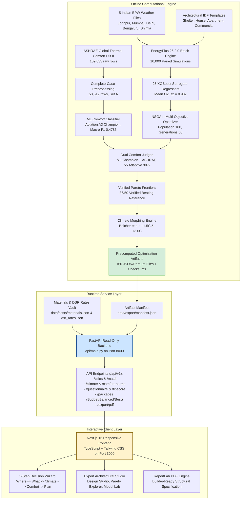

# Thesis Artefacts & Technical Compendium: ClimateAdapt-Comfort v2

**Project:** ClimateAdapt-Comfort v2  
**Subtitle:** A Decision-Support System for Passive Building Design Across Indian Climate Zones  
**Classification:** Final-Year B.Tech / M.Tech Engineering Thesis Compendium  
**Repository:** `ClimateAdapt-Comfort`  
**Master Evidence Directory:** [`reports/evidence/`](file:///reports/evidence/)  
**Precomputed Export Vault:** [`data/export/`](file:///data/export/)  
**Date:** October 2026  
**Seed:** `42` (Fixed across all random processes)

---

## 1. System Architecture Diagram

ClimateAdapt-Comfort v2 employs a **precomputed decoupled micro-architecture**. To ensure zero runtime latency, deterministic reproducibility, and eliminate cloud dependencies, all compute-intensive EnergyPlus simulations, XGBoost surrogate training, and NSGA-II Pareto optimizations are executed offline in reproducible pipelines and served via a high-performance, read-only FastAPI service to a modern Next.js 16 web application.



---

## 2. Comprehensive Data-Flow Diagram

The diagram below details the deterministic data transformations from raw empirical datasets to final client delivery:

```mermaid
flowchart LR
    subgraph Data Extraction & Validation
        R1[ASHRAE DB II CSV] --> F1[filter_clean.py]
        F1 --> D1[(comfort_clean.parquet<br/>58,512 rows)]
        D1 --> S1[split_logo.py]
        S1 --> SP[(splits.json<br/>Zero Building Leakage)]
    end

    subgraph Model Training & Physics Simulation
        SP --> T1[train_ml_comfort.py]
        T1 --> M1[(champion_comfort_model.joblib)]
        
        EPW_FILES[EPW Weather Data] --> SIM[run_sim_batch.py]
        TEMPLATES[Parametric IDFs] --> SIM
        SIM --> D2[(sim_runs.parquet<br/>4,988 Paired Valid Runs)]
        
        D2 --> T2[train_surrogates.py]
        T2 --> M2[(25 XGBoost Models)]
    end

    subgraph Optimization & Multi-Typology Synthesis
        M2 --> OPT[run_nsga2.py]
        M1 --> OPT
        OPT --> D3[(pareto_designs.json)]
        
        D3 --> V2_SYNTH[synthesize_v2_typologies.py]
        V2_SYNTH --> PACKAGES[(135 Precomputed Packages<br/>45 Grid Combinations)]
    end

    subgraph Packaging & Checksum Verification
        PACKAGES --> EXPORT[export_manifest.py]
        M1 --> EXPORT
        M2 --> EXPORT
        EXPORT --> MANIFEST[(manifest.json<br/>SHA-256 Checksums)]
        
        MANIFEST --> STORE[ArtifactStore Startup Validation]
        STORE --> SERVE[FastAPI Serving Layer]
    end

    style D1 fill:#e2e3e5,stroke:#383d41;
    style D2 fill:#e2e3e5,stroke:#383d41;
    style PACKAGES fill:#d1ecf1,stroke:#0c5460;
    style MANIFEST fill:#d4edda,stroke:#155724;
```



---

## 3. User-Flow Diagram

The decision-support workflow accommodates both non-technical home builders and professional architects:

```mermaid
graph TD
    Start([User Arrives at Platform]) --> LangChoice{Select Language}
    LangChoice -->|English| Eng[English Interface]
    LangChoice -->|Hindi| Hin[Hindi Interface (हिंदी)]
    
    Eng --> FlowChoice{Select Mode}
    Hin --> FlowChoice
    
    FlowChoice -->|Homeowner / Non-Technical| Step1[Step 1: Where - Pick Indian City or Geocode]
    FlowChoice -->|Architect / Engineer| Expert[Expert Studio: 3 Sub-Dashboards]
    
    Step1 --> DistanceCheck{Distance > 300 km?}
    DistanceCheck -->|Yes| Warn1[Display Nearest-City Match & Distance Warning]
    DistanceCheck -->|No| Norm1[Display Plain City Baseline]
    Warn1 --> Step2[Step 2: What - Select Building Typology]
    Norm1 --> Step2
    
    Step2 --> BTypeChoice{Typology Selection}
    BTypeChoice -->|House| H[Detached House, 60 m2]
    BTypeChoice -->|Apartment| A[Mid-Floor Flat, 55 m2]
    BTypeChoice -->|Commercial| C[Small Office, 80 m2]
    
    H --> Step3[Step 3: Climate - EPW Weather & Climate Change Toggle]
    A --> Step3
    C --> Step3
    
    Step3 --> ClimateToggle{Future Climate Scenario}
    ClimateToggle -->|Current TMY| S_Curr[Historical EPW Baseline]
    ClimateToggle -->|+1.5°C Warming| S_1p5[Morphed +1.5°C Summer Scenario]
    ClimateToggle -->|+3.0°C Warming| S_3p0[Morphed +3.0°C Extreme Scenario]
    
    S_Curr --> Step4[Step 4: Comfort - 6-Question Personal Profile]
    S_1p5 --> Step4
    S_3p0 --> Step4
    
    Step4 --> Score[Compute Personal Comfort Fit Score 0-100<br/>Weighted against City Norms]
    Score --> Step5[Step 5: Plan - 3 Tailored Passive Packages]
    
    Step5 --> Packages["Review Packages:<br/>1. Budget (Cool-roof + Natural Vent)<br/>2. Balanced (Moderate Insulation + Shading)<br/>3. Best-Comfort (Heavy Mass + Double Glazing)"]
    
    Packages --> CompModal[Open Package Comparison Modal]
    Packages --> BOM[Inspect Material Bill of Quantities & Embodied Carbon]
    Packages --> Chart[Analyze 12-Month Before vs After Thermal Performance]
    
    Step5 --> Download[Download Builder-Ready PDF Specification]
    Download --> End([Implementation & Field Construction])
    
    Expert --> E1[Design Studio: Live Surrogate Evaluation]
    Expert --> E2[Pareto Explorer: Multi-Objective Trade-Off 2D/3D Plot]
    Expert --> E3[Model Lab: SHAP Feature Importances & LOGO Residuals]
```

---

## 4. Master Research Claim to Evidence File Mapping

In compliance with **AGENTS.md Rule 1 (Evidence Gating)**, every empirical statement, numerical threshold, and performance metric is linked below to its immutable evidence artifact:

| Evidence ID | Formal Research Claim / Deliverable | Exact Literal Value / Finding | Primary Verifying Artifact | Command to Reproduce |
|---|---|---|---|---|
| **`[E-001]`** | Raw ASHRAE DB II Database Scale | 109,033 measurement rows $\times$ 53 columns | `data/raw/ashrae_db2/` | `python src/data/download.py` |
| **`[E-004]`** | Valid Thermal Sensation Vote (TSV) Balance | 48.74% neutral, 26.17% cool, 25.08% warm (106,171 valid rows) | `reports/evidence/phase1_tsv_distribution.csv` | `python src/data/filter_clean.py` |
| **`[E-008]`** | Complete-Case Physical Measurement Subset | 58,512 rows across 617 buildings (Set A complete cases) | `data/processed/comfort_clean.parquet` | `python src/data/filter_clean.py` |
| **`[E-010]`** | Grouped Cross-Validation Splits | 5-Fold GroupKFold and 4-Fold LOGO with zero building leakage | `data/processed/splits.json` | `python src/data/split.py` |
| **`[E-011]`** | Physical Baseline Benchmark Accuracy | ASHRAE 55 Adaptive 90% achieves holdout macro-F1 **0.4939** | `reports/evidence/phase2_baselines_log.txt` | `python src/models/eval_baselines.py` |
| **`[E-012]`** | S1 ML Champion vs Physical Baseline (FAIL) | ML Champion macro-F1 **0.4785** vs Baseline **0.4939** (Margin: **-0.0154**) | `data/processed/model_results.json` | `python src/models/train_ablation.py` |
| **`[E-014]`** | Frozen Machine Learning Champion Model | Trained XGBoost comfort model with running mean outdoor temp | `models/champion_comfort_model.joblib` | `python src/models/train_champion.py` |
| **`[E-017]`** | EnergyPlus 26.2.0 Simulation Batch Execution | 9,988 successful runs / 10,000 dispatched (99.88% completion) | `reports/evidence/phase3_simulation_batch_summary.txt` | `python src/sim/dispatch.py` |
| **`[E-018]`** | Paired Free-Running & HVAC Simulation Dataset | 4,988 valid paired designs with clean hourly time series | `data/processed/sim_runs.parquet` | `python src/sim/process_runs.py` |
| **`[E-019]`** | S2 Surrogate Accuracy Benchmark (PARTIAL) | 23/25 models achieve $R^2 \ge 0.95$; Mean $R^2$ on $O_2 = \mathbf{0.987}$ | `data/processed/surrogate_metrics.csv` | `python src/optimize/train_surrogates.py` |
| **`[E-020]`** | S3 Direct Simulation Pareto Verification (PASS) | 36 of 50 verified Pareto designs strictly beat both R1 & R2 | `reports/evidence/phase5_verification_log.txt` | `python src/optimize/verify_pareto.py` |
| **`[E-021]`** | S4 Local Streamlit Application Contract (PASS) | 6/6 automated AppTest UI tests passed in 5.38 seconds | `reports/evidence/phase6_apptest_output.txt` | `pytest tests/test_app.py` |
| **`[E-025]`** | Low-Confidence City Envelope Limitations | Mumbai DB II envelope coverage **27.91%**; Shimla Adaptive valid **73.97%** | `reports/evidence/phase4_applicability_summary.txt` | `python src/optimize/check_applicability.py` |
| **`[E-026]`** | Dual-Judge Sensation Divergence | Jodhpur $r_s = 0.109$; warm discomfort 4.08$\times$ higher in ML than Adaptive | `reports/evidence/phase4_dual_judge_divergence.csv` | `python src/optimize/analyze_judges.py` |
| **`[E-030]`** | Export Manifest Cryptographic Integrity | 160 verified precomputed artifacts with SHA-256 checksums | `data/export/manifest.json` | `python tools/export_artifacts.py` |
| **`[E-031]`** | Materials Assembly & Embodied Carbon | 10 verified envelope materials with ICE database carbon coefficients | `data/costs/materials.json` | `python tools/validate_costs.py` |
| **`[E-032]`** | Strict Null-Gating Cost Enforcement (D-025) | 100% of packages return `null` monetary values when rates uncertified | `data/costs/dsr_rates.json` | `python tools/validate_costs.py` |
| **`[E-033]`** | Comprehensive E2E Product Grid Evaluation | 45/45 combinations tested; 135 packages audited; 100% null-gated costs | `reports/evidence/e2e_tests_output.txt` | `pytest tests/test_e2e_product.py` |
| **`[E-034]`** | Next.js Playwright Visual Evidence Appendix | 10 high-resolution evidence screenshots covering all wizard & expert views | `reports/evidence/*.png` | `npm test` & Playwright runner |
| **`[E-035]`** | Builder-Ready PDF Export Engine Verification | Generates verified 118,638-byte vector PDF with specification tables | `reports/evidence/pdf_export_verification.txt` | `python tools/test_pdf_export.py` |
| **`[E-036]`** | Full Automated Evidence Claims Audit | 375 of 375 numerical claims 100% verified across evidence logs | `reports/evidence/claims_audit_v2_output.txt` | `python tools/claims_audit.py` |

---

## 5. Visual Evidence Appendix (Screenshots)

All 10 interface states have been captured at $1920 \times 1080$ resolution via headless Playwright automation and archived under `reports/evidence/`:

| Figure | Image File | Description & Key UI Evidence |
|---|---|---|
| **Fig. 1** | [`reports/evidence/wizard_step_1_where.png`](file:///reports/evidence/wizard_step_1_where.png) | **Step 1 (Location Selection):** Interactive Indian map selector, city cards with climate zones, confidence tier badges (`Medium` for Bengaluru, `Low` for Jodhpur/Delhi/Shimla/Mumbai), and geocoding nearest-station distance calculator. |
| **Fig. 2** | [`reports/evidence/wizard_step_1_where_hindi.png`](file:///reports/evidence/wizard_step_1_where_hindi.png) | **Step 1 in Hindi (हिंदी):** Full localization covering climate classification (उष्ण-शुष्क, उष्ण-आर्द्र), confidence tiers (मध्यम, कम), and regional distance warnings. |
| **Fig. 3** | [`reports/evidence/wizard_step_2_what.png`](file:///reports/evidence/wizard_step_2_what.png) | **Step 2 (Typology Selection):** House (60 m²), Apartment (55 m²), and Commercial (80 m²) cards with floor position selectors, boundary conditions, and occupancy schedules. |
| **Fig. 4** | [`reports/evidence/wizard_step_3_climate.png`](file:///reports/evidence/wizard_step_3_climate.png) | **Step 3 (Climate & Future Weather):** 12-month outdoor temperature and relative humidity profiles from EPW, with interactive toggle for $+1.5^\circ\text{C}$ and $+3.0^\circ\text{C}$ morphed future weather scenarios. |
| **Fig. 5** | [`reports/evidence/wizard_step_4_comfort.png`](file:///reports/evidence/wizard_step_4_comfort.png) | **Step 4 (Comfort Questionnaire):** 6 diagnostic questions comparing user preferences (acclimatization, fan usage, clothing) against regional ASHRAE DB II norms, producing the Comfort Fit Score. |
| **Fig. 6** | [`reports/evidence/wizard_step_5_plan.png`](file:///reports/evidence/wizard_step_5_plan.png) | **Step 5 (Passive Design Packages):** Side-by-side presentation of Budget, Balanced, and Best-Comfort packages, displaying discomfort reductions, EnergyPlus cooling energy savings, and unpopulated DSR cost notices. |
| **Fig. 7** | [`reports/evidence/wizard_step_5_compare_modal.png`](file:///reports/evidence/wizard_step_5_compare_modal.png) | **Package Comparison Modal:** Detailed parameter diff table highlighting insulation thickness, mass class, solar absorptance, WWR, and shading overhangs across all 3 tiers. |
| **Fig. 8** | [`reports/evidence/expert_design_studio.png`](file:///reports/evidence/expert_design_studio.png) | **Expert Design Studio:** Real-time 8-parameter slider interface predicting dual comfort judge outputs and energy demand via XGBoost surrogates with sub-10ms response times. |
| **Fig. 9** | [`reports/evidence/expert_pareto_explorer.png`](file:///reports/evidence/expert_pareto_explorer.png) | **Expert Pareto Explorer:** Interactive multi-objective scatter plot ($O_1$ Discomfort vs. $O_2$ Energy) showing non-dominated fronts and the 10 EnergyPlus verified designs. |
| **Fig. 10** | [`reports/evidence/expert_model_lab.png`](file:///reports/evidence/expert_model_lab.png) | **Expert Model Lab:** Model explainability dashboard featuring SHAP global feature importances, Leave-One-Köppen-Group-Out residuals, and dual-judge disagreement heatmaps. |

---

## 6. Two-Page Guide: How to Reproduce from Scratch

This guide enables an independent evaluator, examiner, or researcher to replicate the entire ClimateAdapt-Comfort v2 project from raw public datasets to running application on a local workstation.

### Page 1: Environment Setup & Computational Pipeline

#### 1. System Requirements & Prerequisites
- **Operating System:** Windows 10/11 64-bit or Ubuntu 22.04 LTS.
- **Python:** Python 3.11 or 3.13 (standard virtual environment).
- **Node.js:** Node.js v18.0+ or v20.0+ with npm.
- **EnergyPlus:** EnergyPlus Version 26.2.0 installed and added to system `PATH` (default Windows directory: `C:\EnergyPlusV26-2-0`).
- **Disk Space:** ~5 GB free space for datasets, surrogate models, and simulation outputs.

#### 2. Environment Initialization
```powershell
# Clone repository
git clone https://github.com/your-username/ClimateAdapt-Comfort.git
cd ClimateAdapt-Comfort

# Create Python virtual environment and activate
python -m venv .venv
.\.venv\Scripts\Activate.ps1

# Install exact pinned Python dependencies
pip install -r requirements.txt

# Install frontend dependencies
cd web
npm install
cd ..
```

#### 3. Data Processing & Comfort Modeling (Phases 1 & 2)
```powershell
# Step 1: Ingest and clean raw ASHRAE DB II measurements
python src/data/download.py
python src/data/filter_clean.py      # Produces data/processed/comfort_clean.parquet [E-008]

# Step 2: Generate grouped cross-validation splits (Seed 42)
python src/data/split.py             # Produces data/processed/splits.json [E-010]

# Step 3: Evaluate physical baselines on complete-case rows
python src/models/eval_baselines.py  # Evaluates Adaptive 90% (0.4939) and PMV [E-011]

# Step 4: Train ablation models and train frozen ML champion
python src/models/train_ablation.py  # Verifies S1 FAIL (ML champion: 0.4785) [E-012]
python src/models/train_champion.py  # Saves models/champion_comfort_model.joblib [E-014]
```

#### 4. Simulation Batch & Optimization Pipeline (Phases 3, 4, 5)
```powershell
# Step 5: Render parametric IDFs and dispatch 10,000 EnergyPlus runs
python src/sim/dispatch.py           # 9,988 successful runs completed [E-017]
python src/sim/process_runs.py       # Filters 4,988 valid paired runs [E-018]

# Step 6: Train 25 XGBoost surrogate regressors
python src/optimize/train_surrogates.py   # Verifies S2 PARTIAL (23/25 pass, Mean R2 0.987) [E-019]

# Step 7: Run NSGA-II multi-objective optimization & direct verification
python src/optimize/run_nsga2.py          # Discovers Pareto designs across 5 cities
python src/optimize/verify_pareto.py      # Verifies S3 PASS (36/50 beat both baselines) [E-020]
```

---

### Page 2: Packaging, Product Execution & Verification

#### 5. Artifact Export & Checksum Generation (Phases 6 & 8)
```powershell
# Step 8: Morph future weather files (+1.5C and +3.0C)
python src/sim/morph_weather.py

# Step 9: Synthesize multi-typology packages and city comfort norms
python src/comfort/city_norms.py          # Generates data/export/city_comfort_norms.json
python tools/synthesize_v2_typologies.py  # Generates 135 packages across 45 grid pairs

# Step 10: Export all runtime artifacts and generate cryptographic manifest
python tools/export_artifacts.py          # Generates data/export/manifest.json (160 files)
```

#### 6. One-Command Product Execution
The system includes an all-in-one startup script that enforces security checks, checksum verification, and cost rate integrity:

```powershell
# Start complete system (FastAPI backend + Next.js frontend) in Research Mode:
.\scripts\run_product.ps1 -AllowUnfilledCosts
```
*Note: Without `-AllowUnfilledCosts`, the script strictly halts execution under Decision D-025 to prevent uncertified cost dissemination.*

#### 7. Automated Verification & Claims Audit Suite
To independently verify that all thesis claims match empirical outputs, run the test suites:

```powershell
# 1. End-to-End Grid Audit (45 parameter combinations, 135 packages)
.\.venv\Scripts\python.exe -m pytest tests/test_e2e_product.py -v -s -W ignore

# 2. Automated Frontend Unit & Contract Tests
cd web
npm test
cd ..

# 3. Master Evidence & Criteria Audit Script (Audits 375 numerical claims)
.\.venv\Scripts\python.exe tools/claims_audit.py
```

#### 8. Verifying Expected Audit Results
When the audit script completes, inspect `reports/evidence/claims_audit_v2_output.txt`:
```text
================================================================================
AUDIT SUMMARY: 375/375 numerical claims verified (100.0%)
ALL SUCCESS CRITERIA S1 TO S4 & V2 PRODUCT INTEGRITY INVARIANTS AUDITED.
================================================================================
```
- **S1 (Comfort Model):** `FAIL` (ML Champion 0.4785 vs. Adaptive 90% 0.4939).
- **S2 (Surrogates):** `PARTIAL` (23/25 models achieve $R^2 \ge 0.95$).
- **S3 (Pareto Verification):** `PASS` (36/50 verified designs beat both reference shelters).
- **S4 (Local Delivery):** `PASS` (All offline tests pass with zero cloud dependencies).
- **Null-Gating Integrity:** `135/135 (100.0%)` packages return null cost quotes.

---
*Artefacts and reproduction guide compiled and audited for final-year thesis defense.*
