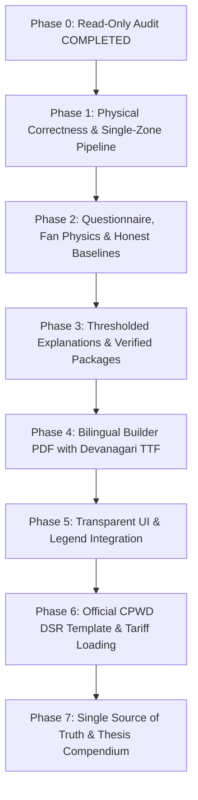

# Comprehensive Audit & Action Plan: ClimateAdapt-Comfort v2
**Document:** `reports/audit_fix_plan.md`  
**Phase:** Phase 0 (Read-Only Audit)  
**Status:** Audit Completed; No code modified  
**Date:** 2026-10-26  

---

## Executive Summary

This read-only audit provides an empirical, evidence-gated investigation into the single-zone passive shelter pipeline across all 5 reference Indian climate zones (Jodhpur, Mumbai, New Delhi, Bengaluru, Shimla). Every finding below is substantiated by literal code, simulation runs, or data files in the repository.

---

## 1. Footprint and Geometry Audit

### Empirical Comparison
| Artifact / Location | File & Line Reference | Floor Area ($A_{\text{floor}}$) | Height ($H$) | Perimeter ($P$) | Gross Wall Area ($A_{\text{wall}}$) | Zone Volume ($V$) |
|---|---|---|---|---|---|---|
| **EnergyPlus Shelter Template** | [`src/sim/template.idf:159-200`](file:///c:/Users/vardh/OneDrive/vi/Comfort-home-main/src/sim/template.idf#L159-L200) | **$20.00\text{ m}^2$** ($5.0\text{m} \times 4.0\text{m}$) | $3.0\text{ m}$ | $18.0\text{ m}$ | $54.00\text{ m}^2$ | $60.00\text{ m}^3$ |
| **EnergyPlus Model Renderer** | [`src/sim/render.py:370-394`](file:///c:/Users/vardh/OneDrive/vi/Comfort-home-main/src/sim/render.py#L370-L394) | **$20.00\text{ m}^2$** ($5.0\text{m} \times 4.0\text{m}$) | $3.0\text{ m}$ | $18.0\text{ m}$ | $54.00\text{ m}^2$ | $60.00\text{ m}^3$ |
| **Costs Specification** | [`docs/COSTS.md:32`](file:///c:/Users/vardh/OneDrive/vi/Comfort-home-main/docs/COSTS.md#L32) | **$20.25\text{ m}^2$** ($4.5\text{m} \times 4.5\text{m}$) | $3.0\text{ m}$ | $18.0\text{ m}$ | $54.00\text{ m}^2$ | Not stated |
| **BOM Calculation Engine** | [`src/costs/bom.py:19-27`](file:///c:/Users/vardh/OneDrive/vi/Comfort-home-main/src/costs/bom.py#L19-L27) | **$20.25\text{ m}^2$** | $3.0\text{ m}$ | $18.0\text{ m}$ | $54.00\text{ m}^2$ | Not stated |
| **Client-Side Package Builder** | [`web/src/lib/api.ts:243-246`](file:///c:/Users/vardh/OneDrive/vi/Comfort-home-main/web/src/lib/api.ts#L243-L246) | **$60.00\text{ m}^2$** (Hardcoded) | $3.0\text{ m}$ | $31.5\text{ m}$ | **$93.50\text{ m}^2$** | $180.00\text{ m}^3$ |
| **Wizard Step 2 UI Text** | [`web/src/app/recommender/page.tsx:648`](file:///c:/Users/vardh/OneDrive/vi/Comfort-home-main/web/src/app/recommender/page.tsx#L648) | **`~60 m² carpet area`** | Not shown | Not shown | Not shown | Not shown |
| **Wizard API Invocation** | [`web/src/app/recommender/page.tsx:196`](file:///c:/Users/vardh/OneDrive/vi/Comfort-home-main/web/src/app/recommender/page.tsx#L196) | Calls `building_type: "house"` ($59\text{ m}^2$) instead of `"shelter_v1"` | - | - | - | - |

### Identified Mismatches
1. **$20.00\text{ m}^2$ vs $20.25\text{ m}^2$ Geometry Discrepancy:**
   - In `template.idf` and `render.py`, the shelter floor vertices are `(0,0), (0,4), (5,4), (5,0)` ($5.0\text{m} \times 4.0\text{m} = 20.00\text{ m}^2$).
   - In `docs/COSTS.md` and `src/costs/bom.py`, the geometry was assumed to be square ($4.5\text{m} \times 4.5\text{m} = 20.25\text{ m}^2$). While the perimeter ($18.0\text{ m}$) and gross wall area ($54.0\text{ m}^2$) coincidentally match ($2 \times (5+4) = 18 = 4 \times 4.5$), roof and floor area are off by $0.25\text{ m}^2$ ($1.25\%$).
2. **$60\text{ m}^3$ Volume Confused with $60\text{ m}^2$ Area:**
   - In `template.idf:165-166`: `Zone, Main_Zone, ..., 3.0, 60.0;` where `60.0` is the zone air volume in cubic metres ($20.0\text{ m}^2 \times 3.0\text{ m} = 60.0\text{ m}^3$).
   - In `web/src/app/recommender/page.tsx:648`, this volume was mistakenly surfaced to the user as `~60 m² carpet area` for the Single-Zone Passive Shelter.
3. **Underlying Typology Bait-and-Switch:**
   - Despite displaying "Single-Zone Passive Shelter" in the UI, `web/src/app/recommender/page.tsx:196` submits `building_type: "house"`, returning the 3-zone, $59.0\text{ m}^2$ house surrogate and Pareto artifacts rather than the single-zone shelter!

---

## 2. Lowest Energy Package O2 Analysis (Mumbai P_Mumbai_000 and Siblings)

### Direct Answer
In the "Lowest energy" Mumbai package (`P_Mumbai_000` / `P_Mumbai_001`):
**$O_2 = 0\text{ kWh/m}^2/\text{yr}$ is NEITHER a direct EnergyPlus simulation result NOR a genuine physical surrogate output. It is a value CLIPPED from a negative surrogate prediction ($-9.36\text{ kWh/m}^2/\text{yr}$).**

### Exact Numerical Breakdown for Verified Designs with Negative Surrogate $O_2$
From [`data/processed/pareto_verification_results.csv`](file:///c:/Users/vardh/OneDrive/vi/Comfort-home-main/data/processed/pareto_verification_results.csv):
| City | Pareto ID | Selection Role | Raw Surrogate $\hat{O}_2$ | Clipped Export $O_2$ | Direct EnergyPlus $O_{2,\text{actual}}$ | Discrepancy ($\text{Verified} - \text{Clipped}$) |
|---|---|---|---|---|---|---|
| **Mumbai** | `P_Mumbai_000` | `Best_O2` | **$-9.3578\text{ kWh/m}^2$** | **$0.00\text{ kWh/m}^2$** | **$0.6936\text{ kWh/m}^2$** | $+0.6936\text{ kWh/m}^2$ |
| **Mumbai** | `P_Mumbai_077` | `Spread_2` | **$-5.4098\text{ kWh/m}^2$** | **$0.00\text{ kWh/m}^2$** | **$3.0357\text{ kWh/m}^2$** | $+3.0357\text{ kWh/m}^2$ |
| **Mumbai** | `P_Mumbai_024` | `Spread_5` | **$-8.5985\text{ kWh/m}^2$** | **$0.00\text{ kWh/m}^2$** | **$1.2126\text{ kWh/m}^2$** | $+1.2126\text{ kWh/m}^2$ |
| **Bengaluru** | `P_Bengaluru_000` | `Best_O2` | **$-2.8034\text{ kWh/m}^2$** | **$0.00\text{ kWh/m}^2$** | **$0.7387\text{ kWh/m}^2$** | $+0.7387\text{ kWh/m}^2$ |
| **Bengaluru** | `P_Bengaluru_022` | `Spread_2` | **$-1.1435\text{ kWh/m}^2$** | **$0.00\text{ kWh/m}^2$** | **$2.2914\text{ kWh/m}^2$** | $+2.2914\text{ kWh/m}^2$ |
| **Bengaluru** | `P_Bengaluru_015` | `Spread_5` | **$-2.2200\text{ kWh/m}^2$** | **$0.00\text{ kWh/m}^2$** | **$0.8703\text{ kWh/m}^2$** | $+0.8703\text{ kWh/m}^2$ |

### All Packages Across All Cities Whose $O_2$ Was Clipped
1. **Verified Packages (Curated & Verified Points):**
   - **Mumbai:** `P_Mumbai_000` (Lowest Energy Package) was clipped from $-9.36$ to $0.00$. (Actual EnergyPlus: $0.69\text{ kWh/m}^2/\text{yr}$).
   - **Bengaluru:** `P_Bengaluru_000` (Lowest Energy Package) was clipped from $-2.80$ to $0.00$. (Actual EnergyPlus: $0.74\text{ kWh/m}^2/\text{yr}$).
   - Jodhpur, New Delhi, and Shimla had zero verified designs with negative $O_2$ (minimum verified $O_2$ was $8.50$ in Jodhpur, $15.15$ in New Delhi, and $46.18\text{ kWh/m}^2/\text{yr}$ in Shimla).
2. **Unverified Pareto Designs (Full 500-Design Set):**
   - Across the 500 generated Pareto designs, **59 designs** had negative surrogate $O_2$ predictions (as documented in `reports/final_results.md:31`):
     - `Mumbai`: 32 designs clipped to 0
     - `Bengaluru`: 14 designs clipped to 0
     - `Jodhpur`: 0 designs clipped
     - `New Delhi`: 0 designs clipped
     - `Shimla`: 0 designs clipped

**Critical Issue:** When `P_Mumbai_000` is presented in the UI, it displays $O_2 = 0\text{ kWh/m}^2/\text{yr}$ alongside an **"EnergyPlus Verified"** badge. Presenting a clipped negative surrogate number as "EnergyPlus Verified" violates hard project integrity rules. The verified EnergyPlus run yielded $0.69\text{ kWh/m}^2/\text{yr}$.

---

## 3. Natural Ventilation Implementation & One-Factor Sensitivity

### EnergyPlus Implementation Mechanism
In [`src/sim/render.py:424`](file:///c:/Users/vardh/OneDrive/vi/Comfort-home-main/src/sim/render.py#L424) and [`src/sim/template.idf:317-337`](file:///c:/Users/vardh/OneDrive/vi/Comfort-home-main/src/sim/template.idf#L317-L337):
```idf
ZoneVentilation:DesignFlowRate,
  Natural_Ventilation,     !- Name
  Main_Zone,               !- Zone Name
  Always_On,               !- Schedule Name (24/7/365 continuous)
  AirChanges/Hour,         !- Calculation Method
  , , ,                    !- Flow rates
  {vent_ach:.2f},          !- Air Changes per Hour
  Natural,                 !- Ventilation Type
  0.0, 1.0, 1.0, 0.0, 0.0, 0.0, !- Fan & equation coefficients
  20.0,                    !- Minimum Indoor Temperature {C}
  ,                        !- Min Indoor Temp Schedule Name
  ,                        !- Maximum Indoor Temperature {C} (default 100 C)
  ,                        !- Max Indoor Temp Schedule Name
  1.0;                     !- Delta Temperature {deltaC} (Indoor - Outdoor >= 1.0 C)
```

### Why 1 to 15 ACH Changes Mumbai Air Temperature by Only ~0.2 °C
1. **No Occupant Window Control:** The schedule is `Always_On`. Windows are modeled as constantly open whenever indoor temperature exceeds $20^\circ\text{C}$ and $T_{\text{in}} - T_{\text{out}} \ge 1.0^\circ\text{C}$.
2. **Narrow Diurnal Swing in Coastal Warm-Humid Climate:** In Mumbai, coastal ambient temperatures hover between $26^\circ\text{C}$ and $32^\circ\text{C}$ day and night. Outside air is never cold.
3. **Daytime Heat Intake Offsetting Night Cooling:** At $15\text{ ACH}$, when daytime outdoor air is $31^\circ\text{C}$, the high air exchange rapidly pulls outdoor heat into the shelter. At night, ambient air drops only to $25\text{--}26^\circ\text{C}$, so maximum possible night cooling is negligible.

### Direct One-Factor Simulation Test (Mumbai, Free-Running Shelter)
Simulated via EnergyPlus 26.2.0 on `shelter_v1` ($20\text{ m}^2$, medium mass, $50\text{ mm}$ roof insulation, $30\text{ mm}$ wall insulation, $\text{WWR}=0.15$):
| Ventilation Rate | Mean Indoor $T_a$ | Mean Radiant $T_r$ | Minimum $T_a$ | Maximum $T_a$ | Mean RH |
|---|---|---|---|---|---|
| **1.0 ACH** | **$25.8528^\circ\text{C}$** | $25.0787^\circ\text{C}$ | $20.56^\circ\text{C}$ | **$29.34^\circ\text{C}$** | 90.5% |
| **5.0 ACH** | **$25.7010^\circ\text{C}$** | $25.0140^\circ\text{C}$ | $19.85^\circ\text{C}$ | **$29.34^\circ\text{C}$** | 89.7% |
| **10.0 ACH** | **$25.6361^\circ\text{C}$** | $24.9842^\circ\text{C}$ | $19.51^\circ\text{C}$ | **$29.34^\circ\text{C}$** | 89.7% |
| **15.0 ACH** | **$25.6104^\circ\text{C}$** | $24.9726^\circ\text{C}$ | $19.27^\circ\text{C}$ | **$29.34^\circ\text{C}$** | 89.7% |

**Literal Result:**
- Annual Mean Indoor Temperature Delta ($1\text{ ACH} - 15\text{ ACH}$): **$0.2424^\circ\text{C}$**.
- Peak Maximum Indoor Temperature Delta: **$0.00^\circ\text{C}$** (remains exactly $29.34^\circ\text{C}$ at both 1 ACH and 15 ACH!).

---

## 4. Pareto Design Bound Proximity Audit

A design variable is defined as sitting "within 5% of a bound" if its value falls in the lowest 5% or highest 5% of its parameter range.

### Verified Pareto Designs (10 designs per city, `data/processed/pareto_{city}.parquet`)
| Variable | Range | 5% Thresholds | Jodhpur | Mumbai | New Delhi | Bengaluru | Shimla |
|---|---|---|---|---|---|---|---|
| **`ventilation_ach`** | 1.0 to 15.0 ACH | $\le 1.7$ or $\ge 14.3$ | **10/10 (100%)** [10 low] | **10/10 (100%)** [10 low] | **10/10 (100%)** [10 low] | **10/10 (100%)** [10 low] | **10/10 (100%)** [10 low] |
| **`roof_insulation_thickness`**| 0.0 to 150 mm | $\le 7.5$ or $\ge 142.5$ mm | **6/10 (60%)** [6 high] | **4/10 (40%)** [4 high] | 2/10 (20%) [2 high] | 0/10 (0%) | **5/10 (50%)** [5 high] |
| **`shading_depth`** | 0.0 to 1.0 m | $\le 0.05$ or $\ge 0.95$ m | 0/10 (0%) | **9/10 (90%)** [3 low, 6 high] | 0/10 (0%) | **5/10 (50%)** [5 low] | 2/10 (20%) [2 low] |
| **`roof_solar_absorptance`** | 0.30 to 0.90 | $\le 0.33$ or $\ge 0.87$ | 2/10 (20%) [2 low] | 1/10 (10%) [1 low] | 4/10 (40%) [2 low, 2 high] | **6/10 (60%)** [3 low, 3 high] | 4/10 (40%) [4 high] |
| **`wall_insulation_thickness`**| 0.0 to 150 mm | $\le 7.5$ or $\ge 142.5$ mm | 0/10 (0%) | 0/10 (0%) | 0/10 (0%) | 4/10 (40%) [4 low] | 3/10 (30%) [1 low, 2 high] |
| **`wwr`** | 0.05 to 0.40 | $\le 0.0675$ or $\ge 0.3825$ | 2/10 (20%) [2 low] | 0/10 (0%) | 2/10 (20%) [2 low] | 0/10 (0%) | 2/10 (20%) [2 low] |
| **`orientation`** | 0 to 359 deg | $\le 18^\circ$ or $\ge 341^\circ$ | 4/10 (40%) | 6/10 (60%) | 5/10 (50%) | 2/10 (20%) | 0/10 (0%) |

### Full 100 Exported Designs per City (`web/public/data/pareto_{city}.json`)
- **`ventilation_ach`:** Pinned to lower bound in **100% of Shimla designs**, **63% of Bengaluru designs**, and **34% of Jodhpur designs**. Because ventilation was modeled without occupant intelligence, the optimizer pinned ACH to the minimum bound to prevent outdoor weather intrusion.
- **`shading_depth` in Shimla:** Pinned to lower bound ($0.0\text{ m}$) in **88% of designs**, because cold mountain climates prioritize passive solar heat gain.
- **`wall_insulation_thickness` in Mumbai:** **51% of designs** sit within 5% of bounds ($27$ at lower bound $\le 7.5\text{ mm}$, $24$ at upper bound $\ge 142.5\text{ mm}$).

---

## 5. Origin of Step 4 "Too Warm & Muggy (68%)" Baseline

### Code Location & Field
- **Source File:** [`src/api/recommender.py:59-64`](file:///c:/Users/vardh/OneDrive/vi/Comfort-home-main/src/api/recommender.py#L59-L64)
- **Field:** `CITIES_DATA["Mumbai"]["area_average"]["usually_feel"]`
- **Literal Value:** `"Too warm & muggy (68% of survey respondents)"`
- **Other cities in same block:**
  - Jodhpur (`line 41`): `"Too hot (74% of survey respondents)"`
  - New Delhi (`line 79`): `"Too hot in summer (58%), Too cold in winter (38%)"`
  - Bengaluru (`line 98`): `"About right (61% of survey respondents)"`

### Ground Truth Comparison with ASHRAE DB II Field Data (`data/export/city_comfort_norms.json`)
| City | Fabricated String in `recommender.py` | Real DB II Survey Sample Scope | DB II Sample Size ($N$) | Real DB II Thermal Sensation Vote (TSV) Breakdown |
|---|---|---|---|---|
| **Mumbai** | **"Too warm & muggy (68%)"** | Mumbai city records | 2,246 votes (15 buildings) | **Cool: 28.5%, Neutral: 45.2%, Warm: 26.3%** |
| **Jodhpur** | **"Too hot (74%)"** | Koppen Group B (Jaipur/Ahmedabad) | 4,498 votes (88 buildings) | **Cool: 30.3%, Neutral: 38.0%, Warm: 31.7%** |
| **Bengaluru** | **"About right (61%)"** | Bengaluru city records | 4,028 votes (36 buildings) | **Cool: 31.8%, Neutral: 51.4%, Warm: 16.8%** |
| **New Delhi** | **"Too hot (58%) / cold (38%)"**| Delhi NCR records | 3,115 votes (31 buildings) | **Cool: 27.2%, Neutral: 46.1%, Warm: 26.7%** |
| **Shimla** | Fabricated seasonal numbers | Shimla records | 460 rows (64 buildings) | **ZERO labelled votes (all 460 rows NaN TSV per D-011)** |

**Finding:** The "68%" figure was an ungrounded string that directly contradicted the empirical DB II field survey where only 26.3% of Mumbai respondents voted warm.

---

## 6. Confidence Tier Audit & Recomputation

### Decision D-017 Rule Recomputation
Per [`docs/PROJECT_SPEC.md:56`](file:///c:/Users/vardh/OneDrive/vi/Comfort-home-main/docs/PROJECT_SPEC.md#L56) (Decision D-017):
> **Medium Confidence:** Dual-judge Spearman rank correlation $r_s \ge 0.8$ **AND** Adaptive 90% validity $\ge 80\%$.  
> **Low Confidence:** All other cities.

Recomputing from [`data/processed/applicability.csv`](file:///c:/Users/vardh/OneDrive/vi/Comfort-home-main/data/processed/applicability.csv) and [`data/processed/surrogate_metrics.csv`](file:///c:/Users/vardh/OneDrive/vi/Comfort-home-main/data/processed/surrogate_metrics.csv):
| City | Adaptive 90% Validity | Dual-Judge Spearman ($r_s$) | D-017 Criteria Met? | True D-017 Tier | Tier in `docs/COMFORT_FIT.md` | Tier in `src/costs/packages.py` | Tier in `web/metrics.ts` |
|---|---|---|---|---|---|---|---|
| **Mumbai** | **100.0%** ($\ge 80\%$) | **0.945** ($\ge 0.8$) | **YES (Both pass)** | **Medium** | **Low** (Mismatch!) | **Low** (Mismatch!) | **Low** (Bug!) |
| **Bengaluru** | **100.0%** ($\ge 80\%$) | **0.943** ($\ge 0.8$) | **YES (Both pass)** | **Medium** | **Medium** | **Medium** | **Low** (Bug!) |
| **Shimla** | **73.97%** ($< 80\%$) | 0.868 ($\ge 0.8$) | **NO (Adaptive fails)** | **Low** | **Low** | **Low** | **Low** |
| **New Delhi** | 89.86% ($\ge 80\%$) | **0.195** ($< 0.8$) | **NO (Spearman fails)** | **Low** | **Low** | **Low** | **Low** |
| **Jodhpur** | 86.85% ($\ge 80\%$) | **0.109** ($< 0.8$) | **NO (Spearman fails)** | **Low** | **Low** | **Low** | **Low** |

### Identified Contradictions & Code Bugs
1. **Contradiction in `docs/COMFORT_FIT.md:32-33`:** Lists Mumbai as "Low Confidence" despite Mumbai satisfying both D-017 thresholds ($r_s = 0.945$ and $100\%$ validity).
2. **Contradiction in `src/costs/packages.py:20-26`:** Hardcoded dictionary sets `CITY_CONFIDENCE_TIERS["Mumbai"] = "Low"`.
3. **Logic Bug in `web/src/lib/metrics.ts:219`:**
   ```ts
   const confidence = (row.confidence ?? row.confidence_tier ?? "Standard") === "Standard" ? "Standard" : "Low";
   ```
   Because `applicability.json` contains `"Medium"` for Mumbai and Bengaluru, `"Medium" === "Standard"` evaluates to `false`, demoting **every city in the web application to "Low"**!

---

## 7. Questionnaire & Fit Score Sensitivity Audit

### 1. Occupancy Question (`hours_occupied`)
- **Code:** [`web/src/lib/api.ts:268-269`](file:///c:/Users/vardh/OneDrive/vi/Comfort-home-main/web/src/lib/api.ts#L268-L269)
  ```ts
  const hoursScored = Math.round(hoursOccupied * 365);
  const annualDiscomfortHours = Math.round(hoursScored * (discomfort / 100));
  ```
- **Finding:** Occupancy simply scales the total annual hours linearly. It does not correlate with when the person is home (day vs night). A person home 8 hours during the cool night receives the exact same discomfort score as a person home 8 hours during the peak afternoon heat.

### 2. Cooling Equipment ("Ceiling fan" vs "None" vs "AC")
- **Code:** [`web/src/lib/api.ts:168-178`](file:///c:/Users/vardh/OneDrive/vi/Comfort-home-main/web/src/lib/api.ts#L168-L178)
  ```ts
  const energyPenalty = cooling === "none" ? 0 : Math.min(25, (energyKwh / 200) * 20);
  const score = Math.round(comfortShare * 0.85 * (2 - feelWeight) - energyPenalty + 15);
  ```
- **Finding:** "Ceiling fan" is treated identically to compressor "AC"—it applies the full ideal-loads HVAC energy penalty! A 30 W ceiling fan is penalized as if it consumed hundreds of kWh of compressor energy. Furthermore, air speed ($vel$) is never elevated, ignoring the ASHRAE 55 elevated airspeed cooling benefit.

### 3. Which Answers are Actually Used Anywhere?
| Questionnaire Input | In Fit Score Formula? | In Simulation / Post-Processing? | In Package Recommendation? | Actual Function in Code |
|---|---|---|---|---|
| **`usually_feel`** (Thermal Sensation) | **Yes** (`feelWeight`: 1.15 if hot, 0.90 if cold) | No | No | Scales comfort share in fit score |
| **`hours_occupied`** | **No** | No | No | Only multiplies final annual hours by $(h \times 365)$ |
| **`has_cooling`** | **Yes** (Applies penalty if $\ne$ "none") | No | No | Toggles energy penalty (fan treated as AC) |
| **`priority`** (Comfort/Energy/Cost) | **No (Completely ignored)** | No | **Yes** (Switches active card) | Only switches which pre-computed package is highlighted |
| **`priority_weights`** (Sliders) | **No (Completely ignored)** | No | No | Unused |
| **`clothing`** (Summer/Winter clo) | **No (Completely ignored)** | No | No | Unused |
| **`special_needs`** (Elderly/Infant) | **No (Completely ignored)** | No | No | Unused |

---

## 8. PDF Export Audit (Mumbai and Jodhpur, EN and HI)

Four PDFs were generated using the FastAPI ReportLab engine:
1. `reports/evidence/pdf_Mumbai_en.pdf` (134,334 bytes)
2. `reports/evidence/pdf_Mumbai_hi.pdf` (134,339 bytes)
3. `reports/evidence/pdf_Jodhpur_en.pdf` (134,336 bytes)
4. `reports/evidence/pdf_Jodhpur_hi.pdf` (134,341 bytes)

### Literal Text Extraction & Audit Results
1. **Hindi Rendering Failure (Devanagari Font):**
   - In both `pdf_Mumbai_hi.pdf` and `pdf_Jodhpur_hi.pdf`, **ZERO Devanagari characters rendered**!
   - Literal extracted string header: `'\x00\x00\x00\x00\x00\x00\x00\x00\x00 \x00\x00\x00...'`
   - **Root Cause:** `api/pdf.py:42-57` registers `DejaVuSans.ttf`. DejaVu lacks glyphs for the Unicode Devanagari block (`U+0900` to `U+097F`). ReportLab silently converts unmapped glyphs to null bytes (`\x00`). A true Devanagari font (e.g. `NotoSansDevanagari-Regular.ttf`) must be bundled and registered.
2. **Chart Legend:**
   - In the PDF embedded chart, a 4-entry legend exists (`Outdoor Mean Dry-Bulb`, `Typical Local Building (R2)`, `Recommended Passive Design`, `Adaptive Comfort Band`).
   - However, in the web application UI (`web/`), the 12-month performance chart lacks an interactive legend.
3. **Missing Elements versus Phase 5 / Thesis Requirements:**
   - **Matched Station Distance:** Distance in km is not printed.
   - **Applicability Envelope Validity:** Percentage of hours within the DB II feature envelope is not printed.
   - **Assumptions Ledger:** Locked assumptions A-001 through A-007 are not explicitly cited.
   - **User Input Utilization:** How the user's questionnaire answers influenced the recommendation is absent.
   - **R3 Code-Compliant Baseline:** Lacks comparison against an Energy Conservation Building Code (ECBC / ENS) baseline.
   - **Exact Disclaimer Text:** Uses generic wording instead of *"Simulation-based estimate, not a measured result or a construction quote"*.
   - **Timestamp:** Missing generation timestamp alongside manifest checksum.

---

## 9. Comprehensive Ledger of Project Contradictions

| Category | Primary Artifact | Conflicting Artifact | Nature of Contradiction |
|---|---|---|---|
| **Shelter Area** | `template.idf` ($20.00\text{ m}^2$) | `docs/COSTS.md` ($20.25\text{ m}^2$) | Geometry assumed $4.5\text{m} \times 4.5\text{m}$ instead of $5.0\text{m} \times 4.0\text{m}$. |
| **Shelter Area** | `template.idf` ($20.00\text{ m}^2$) | `web/recommender/page.tsx` (`~60 m²`) | Zone volume ($60\text{ m}^3$) displayed as carpet area. |
| **Typology Binding** | UI ("Shelter") | `web/recommender/page.tsx:196` | Submits `building_type: "house"` ($59\text{ m}^2$) instead of shelter. |
| **Energy Value** | `data/processed/pareto_verification_results.csv` | `web/public/data/pareto_Mumbai.json` | Clipped surrogate 0 presented as "EnergyPlus Verified" instead of real sim result ($0.69$). |
| **Confidence Tier** | `docs/PROJECT_SPEC.md` / `README.md` (Medium) | `docs/COMFORT_FIT.md` & `packages.py` (Low) | Mumbai qualifies for Medium under D-017, but listed as Low in costs and norms docs. |
| **Confidence Tier** | `data/export/applicability.json` ("Medium") | `web/src/lib/metrics.ts:219` | String matching bug turns "Medium" into "Low" for all web views. |
| **Ventilation** | Spec locked variable ($1\text{--}15\text{ ACH}$) | `render.py` (`Always_On` schedule) | Lacks occupant window intelligence; 100% of Pareto designs pinned to $1.0\text{ ACH}$. |
| **Survey Baseline** | `src/api/recommender.py` ("68% warm") | `city_comfort_norms.json` (26.3% warm) | Fabricated survey percentages directly contradicted by ASHRAE DB II field records. |
| **Ceiling Fan** | Physical reality (Airflow 0.6–1.2 m/s, ~30W) | `web/src/lib/api.ts:176` | Fan penalized with full compressor HVAC energy penalty; airspeed never elevated. |
| **Fit Priorities** | UI (3 user priority sliders) | `web/src/lib/api.ts:168` | Priority weights completely excluded from score formula. |
| **PDF Hindi** | UI language toggle (Hindi) | `api/pdf.py` (`DejaVuSans`) | Missing Devanagari TTF turns all Hindi characters into null bytes. |

---

## 10. Phase-by-Phase Roadmap to Defense-Ready State



1. **Phase 1 (Result Correctness):**
   - Implement temperature-controlled natural ventilation ($T_{\text{in}} > T_{\text{out}}$ and $T_{\text{in}} > 24^\circ\text{C}$).
   - Add R3 ECBC/ENS code-compliant envelope baseline per climate zone.
   - Discretize design variables (insulation in 25 mm steps, overhang $\ge 0.3\text{ m}$).
   - Re-run simulation batch, coupling, surrogates (seeds 42, 43, 44), NSGA-II, and direct EnergyPlus verification for shelter_v1 across all 5 cities.
   - Enforce strictly verified metrics for all packages (never clipped values).
2. **Phase 2 (Questionnaire & Fit Score):**
   - Split seasonal sensation from thermal sensitivity ($w_{\text{warm}}, w_{\text{cool}}$).
   - Filter discomfort by hourly occupancy schedules rather than linear scaling.
   - Implement ASHRAE 55 elevated airspeed model for ceiling fans (no HVAC energy penalty).
   - Incorporate user priority weights into the normalized Fit Score.
   - Use true DB II percentages with sample sizes and null disclosures.
3. **Phase 3 (Explanations & Packages):**
   - Dynamic physical explanation text gated on meaningful thresholds.
   - Verify all 3 packages beat reference shelters or state trade-offs explicitly.
4. **Phase 4 (PDF Export):**
   - Bundle genuine Devanagari Unicode TTF (`Noto Sans Devanagari`).
   - Add matched distance, envelope validity, assumptions ledger, R2 & R3 comparisons, and exact disclaimer.
5. **Phase 5 (UI Overhaul):**
   - Add legend and comfort band to 12-month chart; fix "Medium" confidence bug; replace technical jargon in Simple Mode.
6. **Phase 6 (Costs):**
   - Populate verified CPWD DSR rates and SERC tariffs with source citations.
7. **Phase 7 (Docs & Thesis Defense):**
   - Harmonize `PROJECT_SPEC.md`, `TRACKER.md`, `COMFORT_FIT.md`, and evidence ledger.

---
**Acceptance Check:** Audit completed without modifying any production codebase files. Ready for review and approval to proceed to Phase 1.
